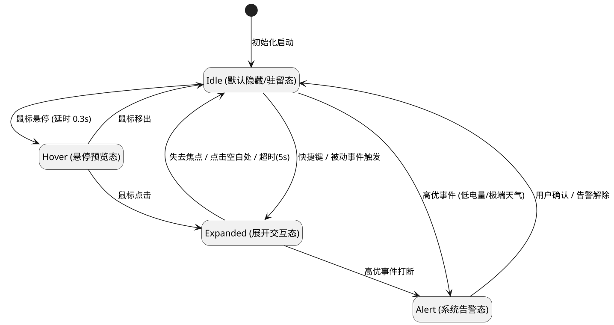
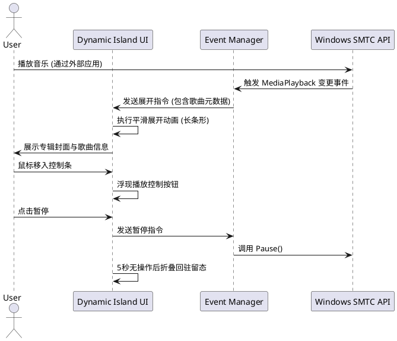

# 灵动岛 (Dynamic Island) - 架构与设计文档

## 1. 状态流转与交互原型图

### 1.1 灵动岛状态流转图 (State Machine)
以下使用 PlantUML 描述灵动岛的核心状态流转机制：

### 1.2 核心功能交互原型时序图
以“音乐/播客控制条”为例的交互时序：

---

## 2. 功能优先级排序表

采用 MoSCoW 方法对功能进行优先级划分，确保研发迭代计划的合理性：

| 功能模块 | 优先级 (Priority) | 复杂度 (Complexity) | 业务价值 | 备注 |
| :--- | :---: | :---: | :--- | :--- |
| 音乐/播客控制条 | **P0 (Must Have)** | 中 | 高 | 核心亮点，视觉效果最佳 |
| 实时天气与空气质量 | **P0 (Must Have)** | 低 | 高 | 高频查看需求，依赖外部API |
| 系统剪切板历史 | **P1 (Should Have)** | 高 | 高 | 提升生产力，需处理多种数据类型 |
| 笔记本电池健康度 | **P1 (Should Have)** | 中 | 中 | 依赖底层 WMI 接口获取损耗数据 |
| 媒体与音频控制(组合) | **P1 (Should Have)** | 低 | 高 | 与音乐控制条复用部分逻辑 |
| 通讯与消息通知(组合) | **P2 (Could Have)** | 高 | 中 | 需对接 Windows Notification 接口 |
| 硬件性能监控(组合) | **P2 (Could Have)** | 中 | 中 | 需持续轮询，注意性能开销 |
| 系统连接状态(组合) | **P3 (Won't Have yet)** | 低 | 低 | 延后至后续版本 |
| 生产力快捷工具(组合) | **P3 (Won't Have yet)** | 中 | 低 | 延后至后续版本 |

---

## 3. 实现技术路线与评估

本应用将采用 **C# + WinUI 3 (Windows App SDK)** 进行开发，以获得现代化的 Fluent Design 视觉体验及原生性能。

### 3.1 核心 API 与框架调用
1. **音乐/播客控制条**：
   - 依赖 `Windows.Media.Control.GlobalSystemMediaTransportControlsSessionManager` (UWP API) 获取全局媒体播放状态及元数据。
2. **实时天气与空气质量**：
   - 依赖第三方 RESTful API (如 OpenWeatherMap 或 和风天气)。
   - 使用 `Windows.Devices.Geolocation.Geolocator` 获取设备经纬度。
3. **系统剪切板历史**：
   - 调用 `Windows.ApplicationModel.DataTransfer.Clipboard` (UWP API) 监听 `Clipboard.ContentChanged` 事件。
   - 采用 SQLite 本地存储历史图文记录。
4. **笔记本电池健康度**：
   - 调用 `Windows.System.Power.PowerManager` 获取基础电量状态。
   - 深入健康度与损耗率需通过 Win32 API (`DeviceIoControl` 结合 `IOCTL_BATTERY_QUERY_INFORMATION`) 或 WMI (`Win32_Battery`) 进行底层轮询。
5. **UI 窗体特性**：
   - 采用 WinUI 3 搭配 P/Invoke 调用 `SetWindowLong` 移除标题栏，实现全透明、异形、置顶窗体 (`WS_EX_LAYERED | WS_EX_TOPMOST`)。

### 3.2 性能开销评估 (Performance Evaluation)
- **内存占用**：由于采用 WinUI 3，基础内存开销预估在 50MB-80MB。通过资源延迟加载(Lazy Loading)和剪切板图片压缩机制，确保常驻内存不超过 100MB。
- **CPU 消耗**：
  - 动画阶段：采用硬件加速 (Composition API)，保障 60fps 平滑动画，CPU 峰值波动 < 2%。
  - 轮询阶段（电池、硬件监控）：设置合理的轮询间隔（如电池 10秒/次，天气 1小时/次），待机 CPU 占用率应严格控制在 < 0.1%。

### 3.3 无障碍兼容性说明 (Accessibility - a11y)
1. **屏幕阅读器支持**：
   - 为所有交互图标和文本元素配置 `AutomationProperties.Name` 和 `AutomationProperties.HelpText`，确保 Windows 讲述人 (Narrator) 能够准确朗读。
2. **键盘导航**：
   - 保证灵动岛在获取焦点后，支持通过 `Tab` 键在内部控件间切换，使用 `Enter` / `Space` 触发点击事件。
3. **高对比度模式**：
   - 监听系统 `AccessibilitySettings.HighContrast` 变更，自动适配 Windows 高对比度主题，确保文字与背景颜色符合 WCAG 2.1 AA 级对比度标准 (至少 4.5:1)。
4. **动画减弱**：
   - 检测系统“在 Windows 中显示动画”设置 (`UISettings.AnimationsEnabled`)。当用户关闭系统动画时，灵动岛的展开/折叠应退化为无过渡的硬切或极简淡入淡出，避免引起前庭不适。
